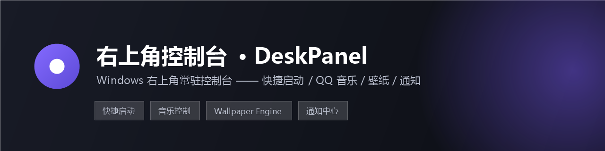
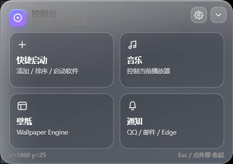
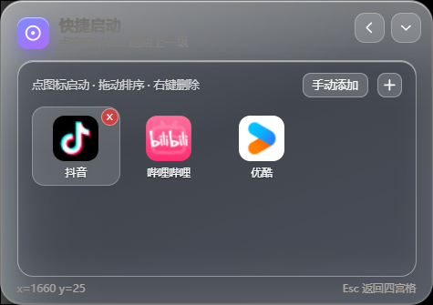
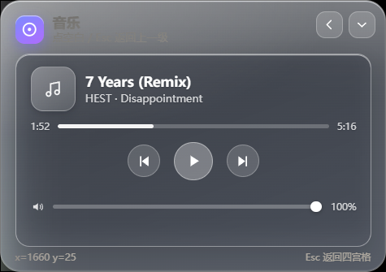
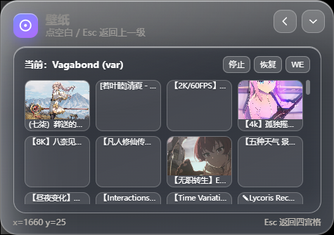
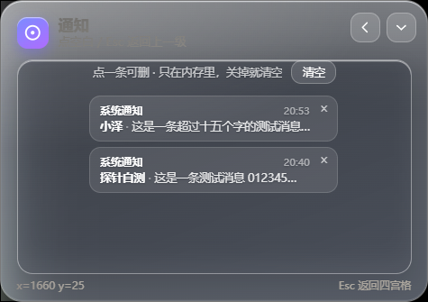

# 右上角控制台 · DeskPanel


> **只支持 Windows。** 不需要是 Windows 11——**Windows 10（1809 及以上）也能跑**（见 [支持的系统](#支持的系统)）。
> **macOS / Linux 跑不起来**，因为四个模块全靠 Windows 专有接口，没有跨平台替代品。

一个常驻屏幕右上角的玻璃质感控制台，给 Windows 用。按一次快捷键就能拉出四宫格，把最常用的四件事收进来：**快捷启动、QQ 音乐控制、Wallpaper Engine 壁纸、系统通知列表**。

不用切窗口、不用找托盘图标，点一下就能用，点一下就收起。



| 快捷启动 | 音乐 |
|---|---|
|  |  |
| **壁纸** | **通知** |
|  |  |

---

## 功能

### 四宫格控制台
- 快捷键 <kbd>Ctrl</kbd>+<kbd>Alt</kbd>+<kbd>Space</kbd> 展开 / 收起；收起后是一条窄条，点它也能展开。
- 点控制台**外面**（桌面、别的软件）立刻整体收起；点**控制台内部但卡片外的空白**退回四宫格（等于按 <kbd>Esc</kbd>）；<kbd>Esc</kbd> 逐级返回。
- 玻璃质感：背后是实时屏幕画面（不是截图），可调透明度与模糊度；有全屏应用（游戏、视频）时自动隐藏。
- 托盘常驻，可退出。

### 快捷启动
- 从开始菜单或任意位置添加 `.lnk` / `.exe` / `.bat` / `.cmd` / `.url`。
- 显示**真实图标**（快捷方式没写图标时，用系统接口兜底提取），名字过长自动省略。
- 点图标即启动，启动成功后控制台自动收起。
- 拖拽排序（重启仍保留）、悬停 <kbd>×</kbd> 或右键删除。

### 音乐控制（只认 QQ 音乐）
- 通过 Windows 官方 SMTC 接口读当前歌曲、歌手、专辑、封面、进度、播放状态。
- 播放 / 暂停 / 上一首 / 下一首；封面随歌切换。
- 音量滑块调的是**QQ 音乐自己的音量**（Core Audio `ISimpleAudioVolume`），不动系统总音量。
- 按进程白名单过滤：只有 `QQMusic*` 的会话会被接管。抖音、浏览器在放声音时不会串进来；QQ 音乐没放歌就显示"未播放"。
- 进度条**只读**：受播放器自身限制，拖动进度做不到（见下方限制说明）。

### 壁纸（Wallpaper Engine）
- 自动找到 Steam 库里的 Wallpaper Engine，读取创意工坊里已订阅的壁纸（标题 + 缩略图）。
- 点缩略图切换壁纸，支持"停止 / 恢复"，也能直接打开 Wallpaper Engine。
- 只调用官方命令行（`wallpaper64.exe -control ...`），不修改它的任何文件。

### 通知
- 读取 Windows 通知中心里的通知（QQ、邮件、Edge 等），显示发送人 + 正文前 15 字。
- 有未读时四宫格的通知卡片右上角显示红点数字；点开列表即视为已读。
- 单条 <kbd>×</kbd> 删除、一键清空；退出软件时清空所有缓存。

---

## 支持的系统

| 系统 | 能不能用 | 说明 |
|---|---|---|
| **Windows 11** | ✅ 可以 | 开发与测试环境（Windows 11 build 26100），四个模块全部实测通过 |
| **Windows 10（1809 及以上）** | ✅ 应该可以 | 用到的接口在这个版本都已提供（SMTC 1809+、通知监听 1809+、Core Audio 一直有），但**没有机器实测**；有问题请开 issue |
| Windows 10（1809 以前） | ❌ 不行 | 缺 `Windows.Media.Control`（SMTC）等接口 |
| **macOS** | ❌ 不行 | 见下 |
| **Linux** | ❌ 不行 | 见下 |

### 为什么 macOS / Linux 跑不起来

不是"没适配"，是核心功能没有跨平台替代品：

| 模块 | 依赖的 Windows 接口 | macOS / Linux 对应物 |
|---|---|---|
| 音乐控制 | SMTC（`Windows.Media.Control.GlobalSystemMediaTransportControlsSessionManager`） | macOS 有私有 `MPNowPlayingInfoCenter`、Linux 各播放器各一套（MPRIS），要重写 |
| 音量滑块 | Core Audio（`ISimpleAudioVolume`，单应用音量） | 要换成 `CoreAudio` / `PulseAudio` 全套封装 |
| 通知 | `UserNotificationListener`（通知中心） | macOS 通知中心不给第三方读，Linux 没有统一通知中心 |
| 壁纸 | Wallpaper Engine（Windows 独占软件）+ 官方命令行 | 无对应软件 |
| 全屏探测 / 透明置顶窗 | `user32` / `gdi32`（`EnumWindows`、`PrintWindow`、DPI） | 完全不同的一套（Cocoa / X11 / Wayland） |
| 启动器 | `.cmd` + `.vbs` + `shell.openPath` | 无 |

要移植等于重写 `native/` 下全部四个助手 + 一半主进程。短期不做；如果以后要做，macOS 版会先做（音乐 + 快捷启动 + 全屏隐藏），通知和壁纸大概率没有。

## 环境要求

- **Windows 10（1809+）或 Windows 11**（64 位）
- [Node.js](https://nodejs.org/) 18 或更高
- .NET Framework 4.x（Windows 自带，用来编译 `native/` 下三个几十行的小工具）

可选（不装也不影响启动，对应模块会提示未找到）：

- **QQ 音乐** —— 音乐模块
- **Wallpaper Engine**（Steam 版）—— 壁纸模块

## 快速开始

```bash
git clone https://github.com/<your-name>/deskpanel.git
cd deskpanel
npm install
npm start
```

或者直接双击目录里的 **`start.cmd`**：它会自动装依赖、编译 `native/` 小工具，然后启动。

> 首次启动如果系统弹出"通知访问"权限，允许即可；拒绝的话通知模块会一直为空。

## 使用

| 操作 | 效果 |
|---|---|
| <kbd>Ctrl</kbd>+<kbd>Alt</kbd>+<kbd>Space</kbd> | 展开 / 收起控制台 |
| 点窄条 | 展开控制台 |
| 点控制台外面的任意位置 | 整体收起 |
| 点卡片外的内部空白 / <kbd>Esc</kbd> | 退回四宫格 |
| 快捷启动里拖动图标 | 调整顺序 |
| 悬停图标右上角 <kbd>×</kbd> / 右键 | 删除该条目 |
| 齿轮图标 | 调透明度、模糊度 |

## 目录结构

```
deskpanel/
├─ src/
│  ├─ main/
│  │  ├─ main.js          # 主进程：窗口、托盘、全屏探测、四个模块的 IPC
│  │  └─ preload.js       # 暴露给页面的安全 API
│  └─ renderer/
│     ├─ index.html       # 页面结构（四宫格 + 四个模块面板）
│     ├─ app.js           # 交互逻辑
│     └─ glass.css        # 玻璃拟态样式
├─ native/                # 调 Windows 官方接口用的小助手
│  ├─ smtc-helper.ps1     # SMTC：歌曲信息 / 播放控制 / 音量
│  ├─ notif-helper.ps1    # 通知监听：UserNotificationListener
│  ├─ fullscreen-probe.ps1# 全屏探测
│  ├─ AudioVol.cs         # Core Audio 单应用音量
│  ├─ SmtcCover.cs        # 读取 SMTC 封面（WinRT 缩略图流）
│  ├─ IconGrab.cs         # 提取 exe/lnk 的真实图标
│  └─ build.ps1           # 用系统自带 csc.exe 编译上面三个
├─ assets/                # 托盘图标
├─ docs/                  # 设计说明与截图
└─ start.cmd              # 一键启动
```

## 实现说明（为什么需要 `native/` 里的小工具）

Electron 本身说不了 WinRT，也拿不到 SMTC / 通知中心的数据。所以每个需要系统接口的模块都是"主进程 + 小助手"：

1. 主进程把一条命令写进 `%TEMP%\deskpanel-*.cmd`，再用 `shell.openPath` 交给系统执行（**不用 `child_process.spawn`**，见下）。
2. 小助手（PowerShell）调用微软官方 API，把结果原子写进 `%TEMP%\deskpanel-*.json`。
3. 主进程定时读这个 JSON，通过 IPC 推给页面。

有几个坑是踩过之后固化成写法的，改代码前值得知道：

- **不能用 `child_process.spawn`**：某些环境下 Electron 起的子进程会立刻退出、拿不到输出。统一改成"写 .cmd → `shell.openPath`"。
- **`.ps1` 带中文时必须存成 UTF-8 + BOM**：Windows PowerShell 5.1 会把无 BOM 的文件按 ANSI 读，中文注释会把后面的语句一起吞掉。
- **临时文件的路径不能含中文**：.cmd 要交给 `cmd.exe` 执行，中文路径会变乱码。
- **透明置顶窗口会被 Chromium 降频**：`webPreferences` 里必须 `backgroundThrottling: false`，否则界面会"冻住"。

## 已知限制

| 限制 | 原因 |
|---|---|
| 只有 QQ 音乐会显示在音乐模块 | 按需求做了进程白名单；否则任何播放器都会串进来 |
| QQ 音乐暂停时没有封面 | SMTC 这时不提供缩略图，界面显示音符占位图 |
| 进度条不能拖 | QQ 音乐不支持 `TryChangePlaybackPosition`，接口返回 `canSeek=false` |
| 微信消息读不到 | 微信 4.x 不走 Windows 系统通知（Qt 自绘弹窗），`UserNotificationListener` 永远等不到；不注入、不读数据库 |
| 壁纸模块需要 Wallpaper Engine | 通过它的官方命令行控制；没装就只显示提示 |
| 商店应用（UWP）的图标可能仍是通用图标 | 系统限制；可手动添加 `.lnk` 试试 |

## 隐私

- 不联网、不上传任何数据。
- 通知只存在内存里，关掉软件即清空；临时文件在退出时删除。
- 不注入任何进程、不读取微信数据库、不抓包。

## 开发

```bash
npm start                 # 启动
npm run build:native      # 只重新编译 native 小工具

# 调试模式：渲染进程日志会汇总到 %TEMP%\dp-out.txt
node_modules\electron\dist\electron.exe . --panel-debug
```

数据文件位置：

- 快捷启动列表：`%APPDATA%\右上角控制台\apps.json`
- 音乐 / 通知的中间状态：`%TEMP%\deskpanel-media.json`、`%TEMP%\deskpanel-notif.json`

设计取舍写在 [docs/design.md](docs/design.md)。

## 许可

[MIT](LICENSE)
